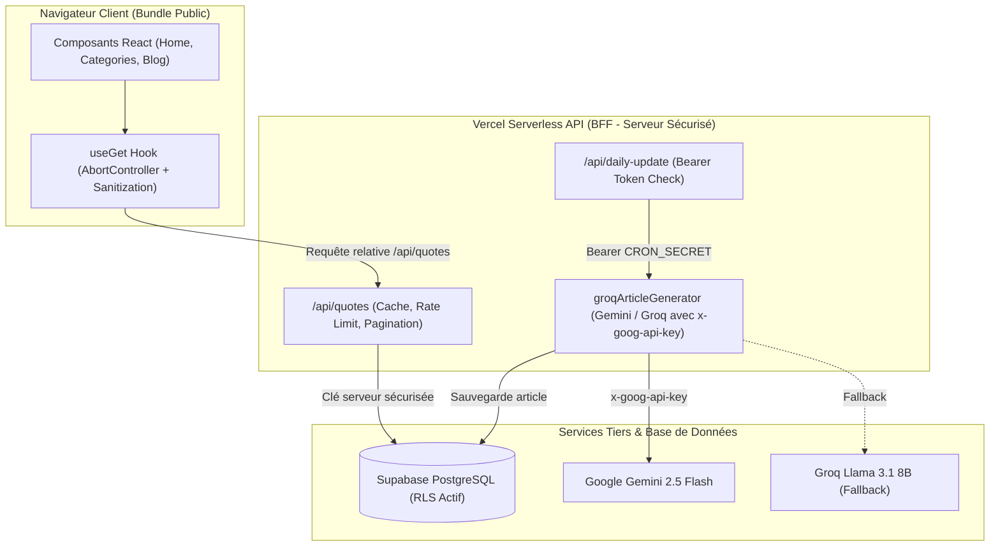

# Sécurisation & Architecture BFF (Quoter) - Implementation Plan

> **For agentic workers:** REQUIRED SUB-SKILL: Use superpowers:subagent-driven-development to implement this plan task-by-task. Steps use checkbox (`- [ ]`) syntax for tracking.

**Goal:** Éradiquer l'exposition publique des accès Supabase via une architecture BFF (Backend-For-Frontend), verrouiller l'authentification du cron Vercel, et durcir le générateur IA contre les fuites de secrets et injections de prompt.

**Architecture:** 
1. Le frontend React ne contacte plus Supabase directement avec une clé exposée dans le bundle : il interroge des Serverless Functions Vercel (`/api/quotes`).
2. Les clés Supabase (`SUPABASE_URL`, `SUPABASE_SERVICE_ROLE_KEY` / `SUPABASE_ANON_KEY`) restent 100% confinées côté serveur dans l'environnement Vercel.
3. L'endpoint `/api/daily-update` est verrouillé par un token Bearer strict (`CRON_SECRET`) avec comparaison temporelle constante (`timingSafeEqual`), sans fuite d'erreurs.
4. Le générateur multi-modèles (Gemini / Groq) utilise l'en-tête `x-goog-api-key`, sépare les rôles système pour neutraliser les injections de prompt, et valide strictement le schéma JSON avant persistance.

**Architecture Diagram:**

**Tech Stack:** React 18, Tailwind CSS, Vercel Serverless (Node.js), Supabase JS, Google Gemini API, Jest / node:test, rtk.

---

## Global Constraints

- Respect absolu de la règle des 300 lignes max par fichier source (Anti-Monolithe).
- Zéro clé API ou secret écrit dans le code source (AgentShield).
- Toutes les commandes terminal exécutées via le proxy `rtk`.
- Rulings d'architecture persistés dans `.ecc/memory/`.

---

### Task 1: Durcissement Sécurité du Générateur IA (`groqArticleGenerator.js`)

**Files:**
- Modify: `api/lib/groqArticleGenerator.js`
- Test: `api/lib/articleGenerator.test.js`

**Interfaces:**
- Consumes: `{ quote_text, quote_author, category, id }`
- Produces: `generateArticle(quote, today) => Promise<ArticleObject>`

- [ ] **Step 1: Écrire les tests unitaires pour la sécurité du générateur**
  - Vérifier que la clé Gemini n'est pas passée dans l'URL.
  - Vérifier que l'en-tête `x-goog-api-key` est bien transmis.
  - Vérifier la validation stricte du schéma (rejet si `points` n'est pas un tableau).
  - Vérifier la neutralisation des injections de prompt (encadrement `<quote_data>`).
- [ ] **Step 2: Exécuter les tests via rtk et vérifier l'échec (RED)**
- [ ] **Step 3: Implémenter les correctifs dans `api/lib/groqArticleGenerator.js` (GREEN)**
  - Passer `apiKey` dans `headers['x-goog-api-key']`.
  - Isoler le rôle système avec consignes fermées.
  - Valider le schéma d'article extrait (champs obligatoires et types).
- [ ] **Step 4: Re-tester et valider le passage au vert (GREEN)**
- [ ] **Step 5: Enregistrer le ruling**

---

### Task 2: Verrouillage Cryptographique du Cron (`api/daily-update.js`)

**Files:**
- Modify: `api/daily-update.js`
- Test: `api/daily-update.test.js`

**Interfaces:**
- Consumes: HTTP Request (`req.headers.authorization`)
- Produces: HTTP 200 `{ success: true, ... }` ou 401 `{ error: "Unauthorized" }`

- [ ] **Step 1: Écrire les tests d'authentification du cron**
  - Rejet des requêtes sans header `Authorization`.
  - Rejet des requêtes avec `User-Agent: vercel-cron` seul (suppression du spoofing).
  - Rejet si `CRON_SECRET` n'est pas défini côté serveur.
  - Acceptation avec `Authorization: Bearer <valid_token>`.
- [ ] **Step 2: Exécuter les tests et constater l'échec (RED)**
- [ ] **Step 3: Implémenter le contrôle d'authentification strict (GREEN)**
  - Supprimer tout contrôle basé sur `User-Agent` ou `x-vercel-oidc-token` non vérifié.
  - Utiliser `crypto.timingSafeEqual` pour empêcher les attaques temporelles.
  - Masquer les détails d'erreurs en production dans la réponse 500.
- [ ] **Step 4: Re-tester et valider le passage au vert**
- [ ] **Step 5: Enregistrer le ruling**

---

### Task 3: Création de la Route API BFF (`/api/quotes.js`)

**Files:**
- Create: `api/quotes.js`
- Test: `api/quotes.test.js`

**Interfaces:**
- Consumes: HTTP GET `/api/quotes?query=...&category=...&name=...&page=...`
- Produces: `{ data: Quote[], count: number, page: number }`

- [ ] **Step 1: Écrire les tests pour l'endpoint BFF**
  - Test de filtrage par catégorie et auteur.
  - Test de recherche plein texte avec sanitisation PostgREST.
  - Test de pagination serveur (`range`).
- [ ] **Step 2: Exécuter les tests (RED)**
- [ ] **Step 3: Implémenter `/api/quotes.js` (GREEN)**
  - Initialiser Supabase côté serveur avec `SUPABASE_URL` et `SUPABASE_SERVICE_ROLE_KEY` (ou ANON_KEY serveur).
  - Valider et assainir les paramètres de requête.
  - Appliquer pagination et renvoyer la réponse sans exposer de clé.
- [ ] **Step 4: Re-tester et valider le passage au vert**
- [ ] **Step 5: Enregistrer le ruling**

---

### Task 4: Adaptation du Hook Frontend `useGet.js` & Nettoyage des Clés

**Files:**
- Modify: `src/hooks/useGet.js`
- Modify: `src/utils/supabaseClient.js`
- Test: `src/hooks/useGet.test.js`

**Interfaces:**
- Consumes: `useGet({ query, name, category, page })`
- Produces: `{ data, isLoading, error, totalCount }`

- [ ] **Step 1: Écrire les tests pour `useGet` avec `AbortController`**
  - Vérifier l'annulation des requêtes obsolètes lors des frappes rapides.
  - Vérifier le repli gracieux en cas d'erreur réseau.
- [ ] **Step 2: Exécuter les tests (RED)**
- [ ] **Step 3: Implémenter l'appel vers `/api/quotes` au lieu du SDK client direct (GREEN)**
  - Utiliser l'API native `fetch` vers `/api/quotes`.
  - Intégrer l'`AbortController`.
  - Supprimer l'obligation de `REACT_APP_SUPABASE_KEY` côté navigateur.
- [ ] **Step 4: Re-tester et valider le passage au vert**
- [ ] **Step 5: Enregistrer le ruling**

---

### Task 5: Formalisation de l'ADR dans `.ecc/memory/`

**Files:**
- Create: `.ecc/memory/0002-bff-and-gemini-security.md`

- [ ] **Step 1: Rédiger la fiche d'arbitrage d'architecture selon les standards ECC**
  - Context : Révocation modèle Groq, exposition publique des clés Supabase.
  - Decision : Architecture BFF, bascule Gemini 2.5 Flash, verrouillage Cron timingSafeEqual.
  - Consequences : Élimination des clés publiques, zéro scraping direct, conformité PreDeploy-Gate.
